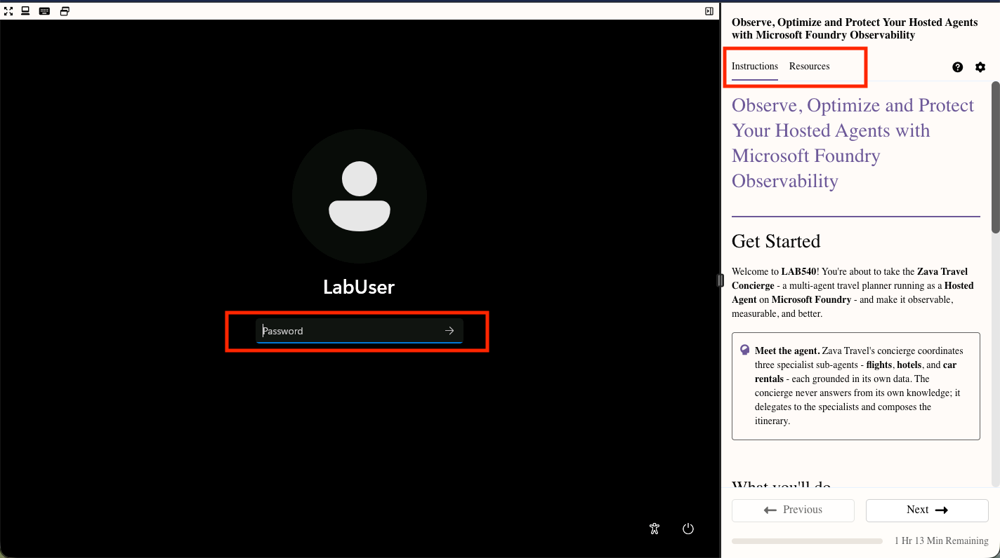

# Get Started

Welcome to **LAB540**! You're about to take the **Zava Travel Concierge** — a multi-agent travel planner running as a **Hosted Agent** on **Microsoft Foundry** — and make it observable, measurable, and better.

>[!Knowledge] **Meet the agent.** Zava Travel's concierge coordinates three specialist sub-agents — *flights*, *hotels*, and *car rentals* — each grounded in its own data. The concierge never answers from its own knowledge; it delegates to the specialists and composes the itinerary.

 

## What you'll do

This lab runs in three short stages:

1. **Setup** - Get the infrastructure and your Codespace ready.
2. **Observe** - Explore the hosted agent in the playground. Learn Foundry's built-in observability features.
3. **Optimize** - Run the eval → fix → redeploy loop with Microsoft Foundry Skills and GitHub Copilot.

>[!Note] **Level:** 200–300 &nbsp;•&nbsp; **Duration:** 60 minutes

 

## Before you start

Check that your lab environment loaded correctly as shown in the image:

1. [] You see the **Instructions** and  **Resources** tabs at right.
1. [] You see the **login screen** for the virtual machine at left.

   

1. [] Click the **Resources** tab. Verify it has **Subscription**, **Username**, and **TAP** values filled in.
1. [] Switch back to the **Instructions** tab to continue.

>[!Alert] If you don't see these values filled in, raise your hand and ask a proctor for help before continuing.
