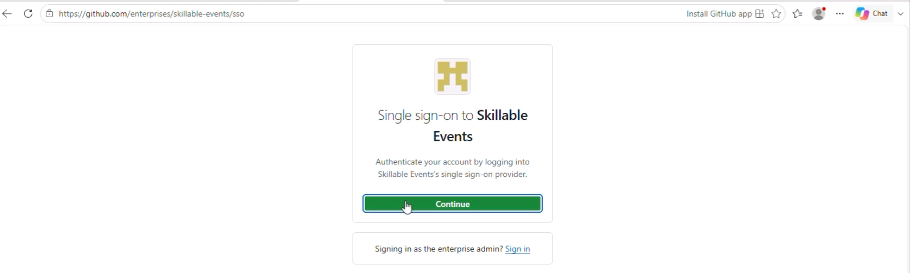
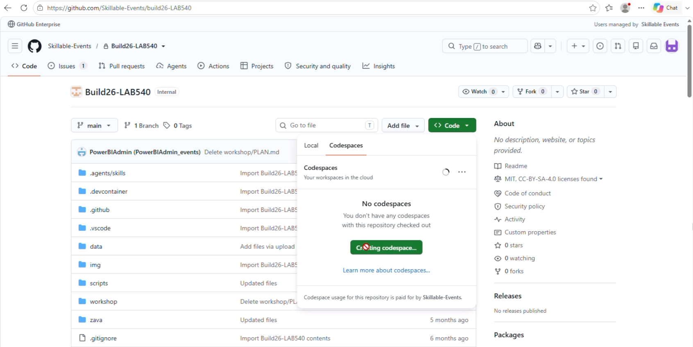
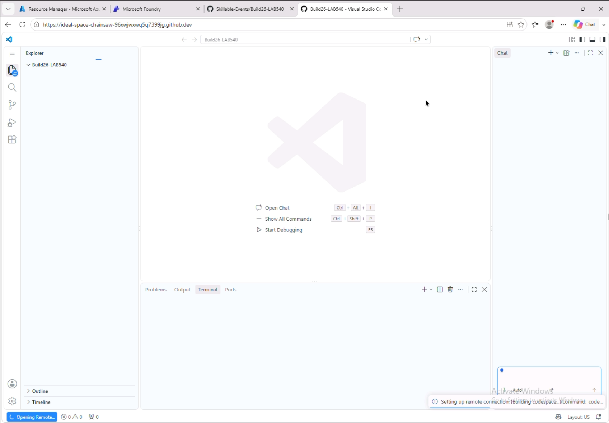

# Setup Tab 3: GitHub Codespaces

We will use **GitHub Codespace** as the development environment for this lab. It takes a few minutes to load - so we will start the process in this step and let it complete in the background.

## Sign in to the Skillable GitHub org

1. [] Open a new browser tab and navigate to +++https://github.com/enterprises/skillable-events/sso+++

   

1. [] Click **Continue**. You’ll be authenticated with the same Azure lab credentials. 

>[!Alert] If you receive a **404** error, wait for several minutes and then try again. This is likely because the GitHub Enterprise license is still being activated.
 
 

## Launch the Codespace

1. [] Copy the repository link below to the address bar in this tab, and click to navigate to the lab repo page: ++https://aka.ms/build26/lab540/skillable++

1. [] Click the green **Code** button for a drop down menu. Select the **Codespaces** tab and click the **Create codespace on main** button shown.

   

> **A new browser tab should open with a VS Code session loading.** This is your GitHub Codespaces tab. 

>[!Alert] **Don't wait for the page to load.** GitHub Codespaces can take several minutes to build. Leave this tab open and move to the next step. We'll come back here later in the lab to check if it is ready.

 

---

> ✅ **Success:**  Your GitHub Codespaces environment is loading.
>

> 🏁 **Stage 1 (Setup) is complete.** 
Your browser should now have four open tabs - Azure Portal, Foundry Portal, GitHub Repository, GitHub Codespaces - as shown in the image above.
