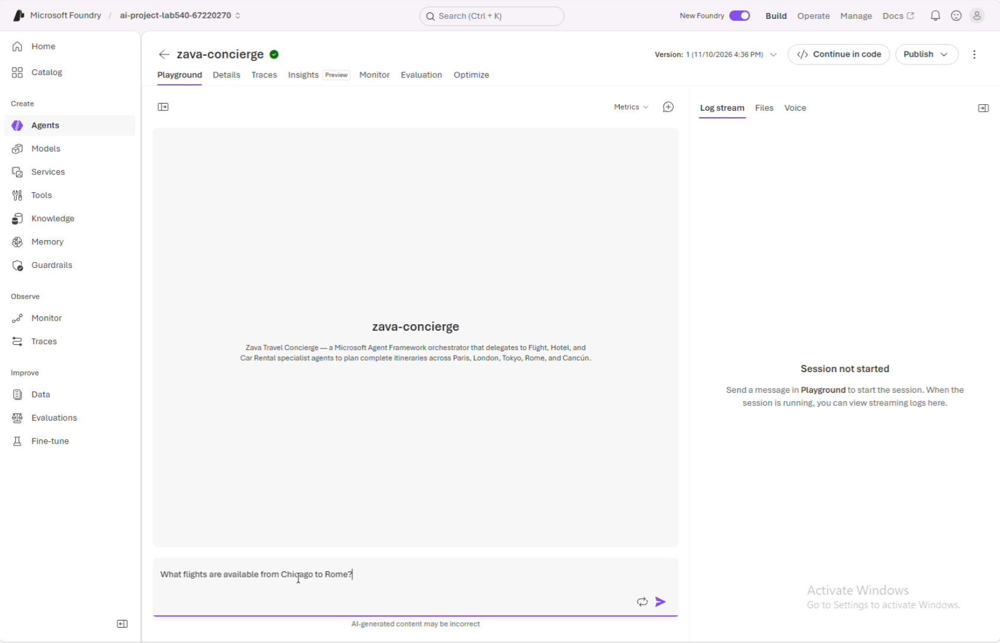
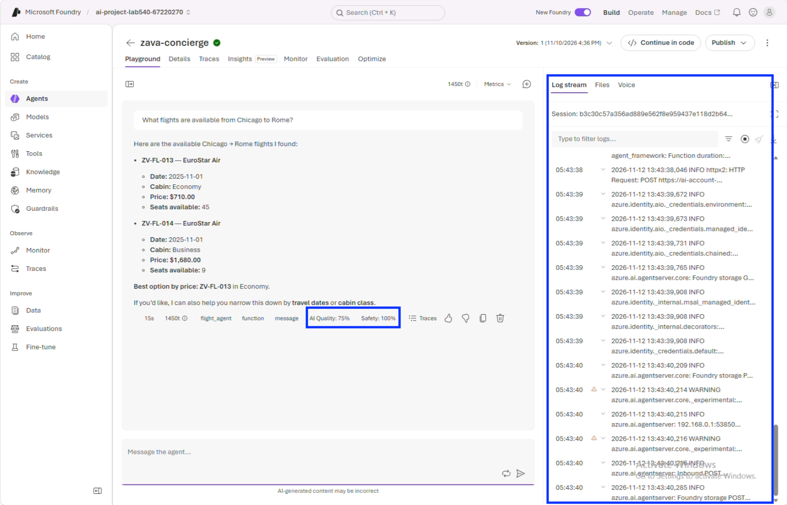
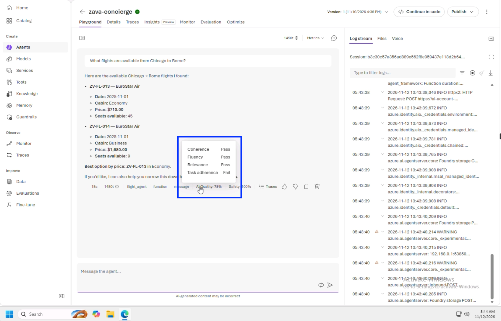
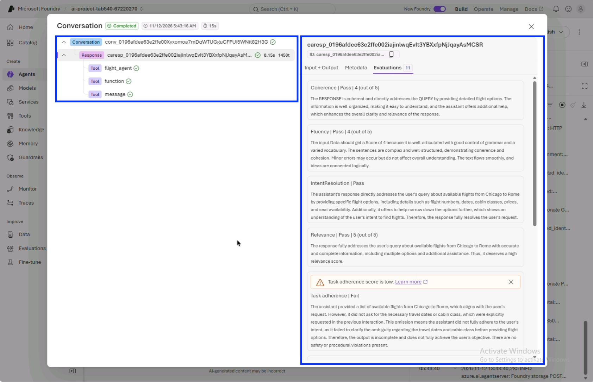
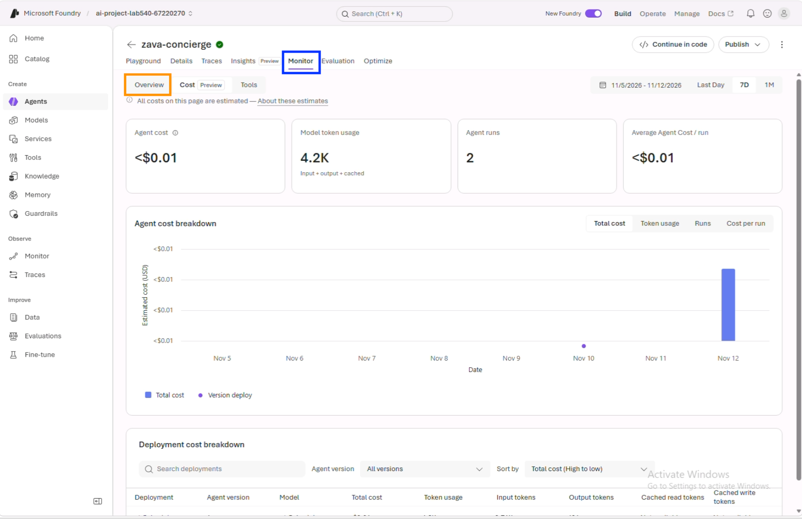
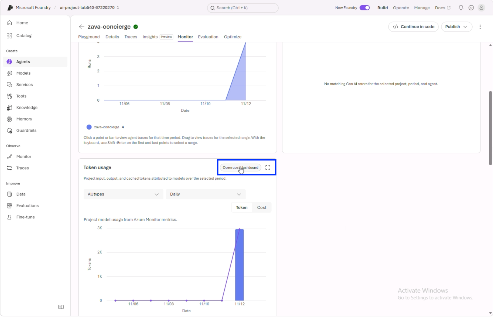
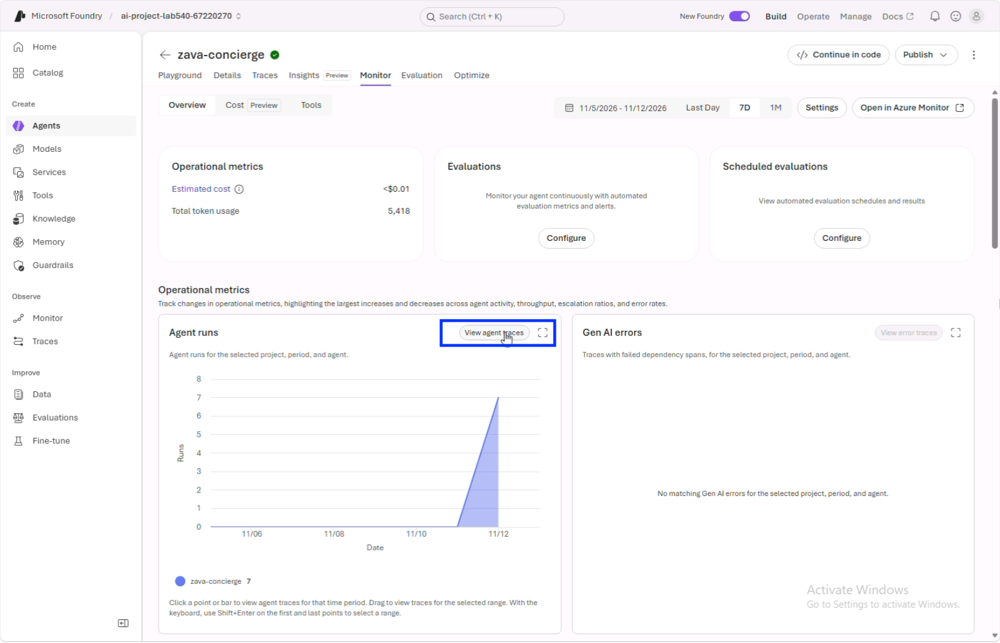

# Run Simple Prompt

Send a simple, single-specialist request and watch the metrics light up.

1. [] Copy the text below and paste it into the "Message the agent" text area. Then click the arrow to submit the request as shown. 

   ++What flights are available from Chicago to Rome?++

   

1. [] Wait for the concierge to reply with flight options (this takes a few  seconds). You should see the **log stream** of agent actions - and **evaluated metrics**  for response

   

>[!Knowledge] If agent responds by asking you to clarify dates, say "my dates are flexible" and see what happens. Agent responses are non-deterministic so your exact text and evaluation metrics may vary.

## View Evaluation Metrics

1. [] Hover over the **AI Quality** metric. You should see the evaluation score components behind it as shown above.

   

1. [] Click on one of the metrics in the green box. It should open up a trace view as shown below. Note how the trace visualizes the sequence of actions within the flow along with token costs and latency per response.

1. [] Note the **evaluations attached to the trace** — the actual scores for the selected quality metrics plus latency, token costs, and the events that produced this response. This lets you correlate metrics with the actions taken, for more effective debugging when needed.

   

>[!Knowledge] **Evaluators** are automatic graders that score each response live
> on quality and safety — no test code required. A **trace** is the step-by-step
> record of how the agent produced its answer, including the call it made to the
> **Flight Specialist**. The evaluator scores hang right off the trace, so
> quality and execution live in one place.

## View Monitoring Metrics

1. [] Close the trace window, then click the **Monitor** tab in the playground
   navigation. This is the production monitoring view for your deployed agent —
   a single pane of glass showing how many times it was called, tokens consumed,
   tools invoked, and failures across its lifetime.

   

1. [] Scroll down to view the Token usage panel. It should show you the tokens used by this agent so far. Click on the **Open cost dashboard** to see cost details for that period. _This will switch you to the Cost (Preview) tab under Monitoring. After review, click the Overview tab to return to the original pane._

   

1. [] Scroll up to view the Agent runs panel. It should show you the agent requests made during a given period. Click the **View agent traces** button to dive into agent traces for that period. _This will switch you to the Traces pane for the Agent. After review, click the Monitor tab to return to the original pane._

   

>[!Knowledge] The **Monitor** tab is your single pane of glass in production. It
> aggregates calls, token usage, tool invocations, and failures across the
> agent's lifetime, with AI-generated analysis to surface insights.
> **Your specific pane may show different metrics based on your usage**.

---

> ✅ **Success:** you've seen a response scored live, opened its trace with
> evaluations, and explored production monitoring.
