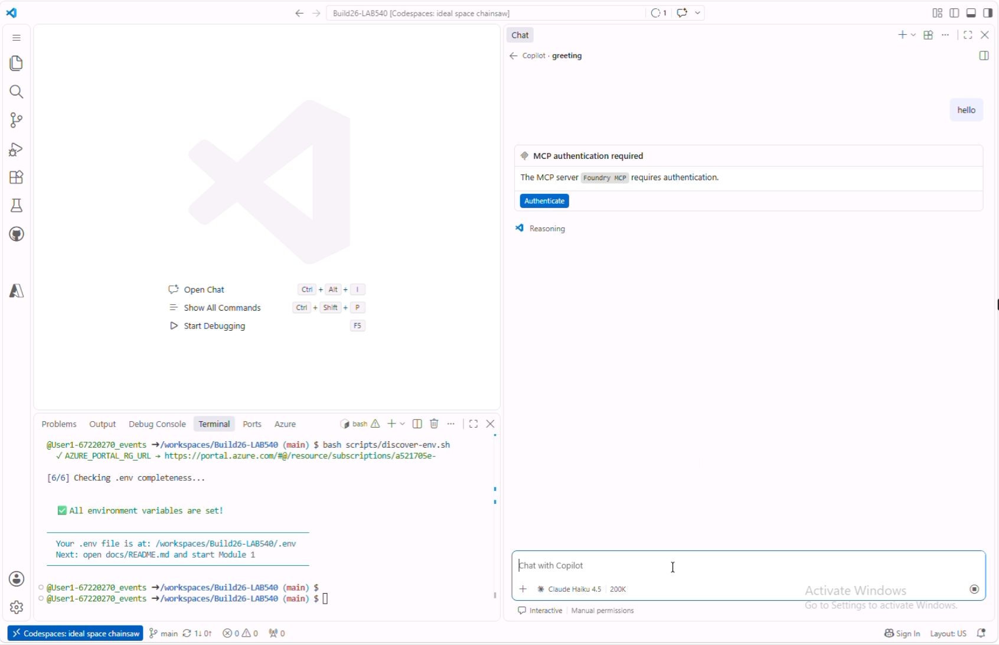
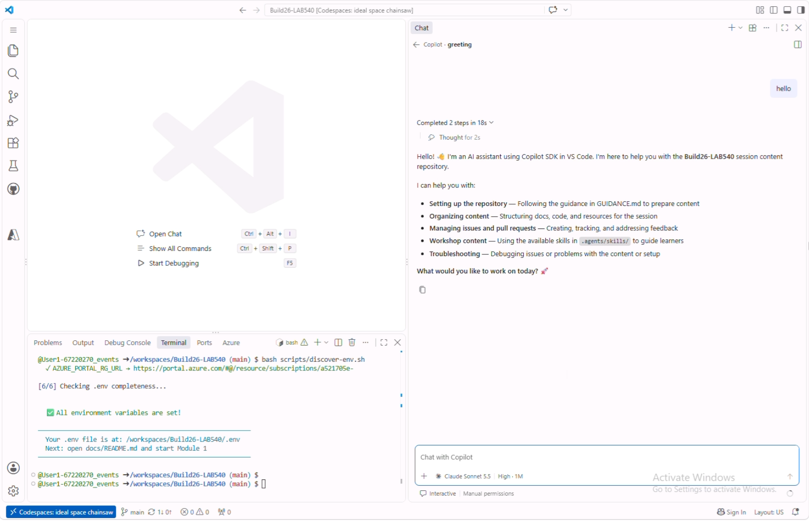
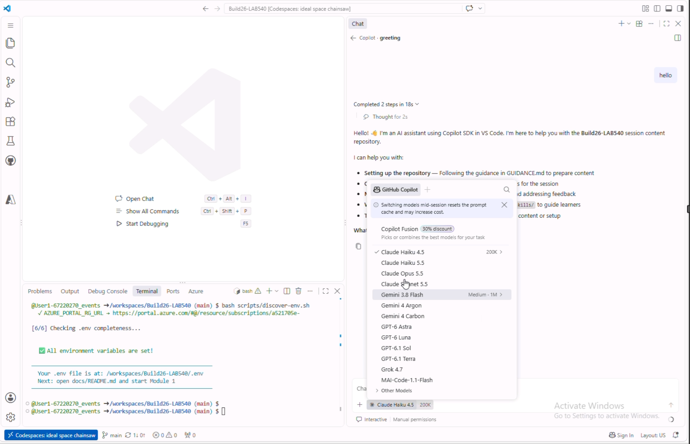
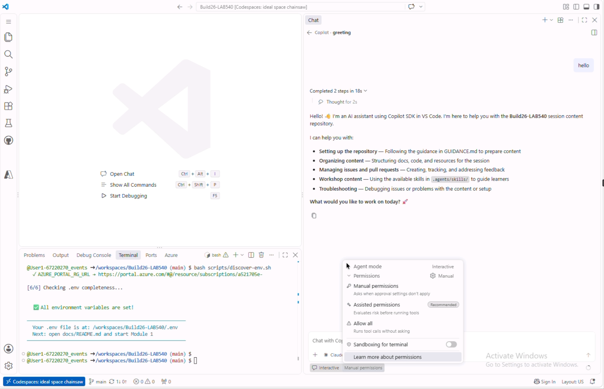
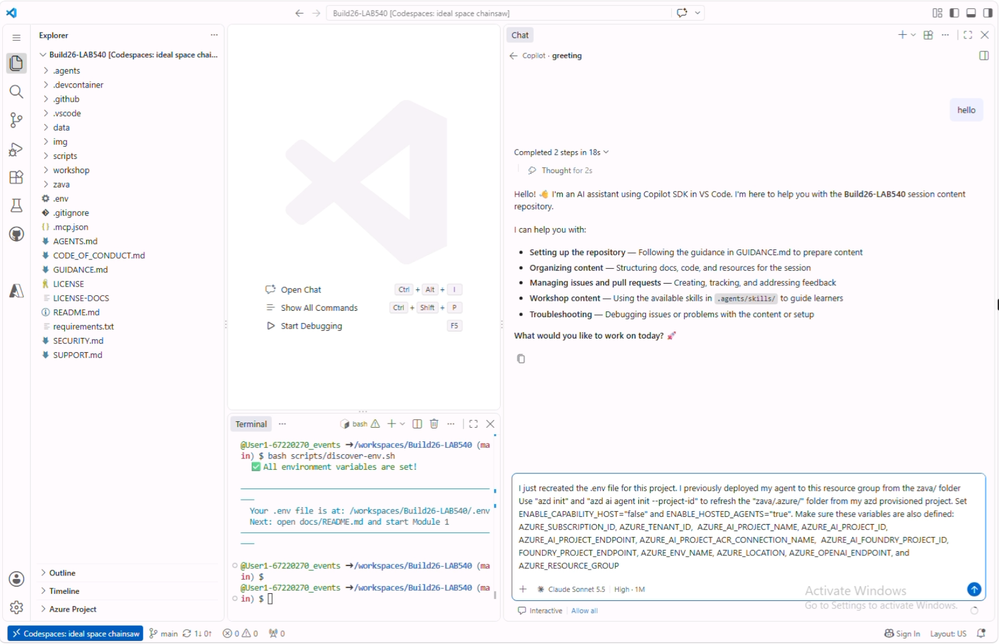
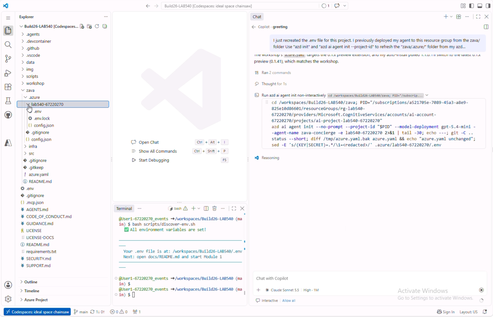

# Activate Copilot

You'll drive the optimize loop by talking to **GitHub Copilot**, which uses the
**Foundry MCP** and the **microsoft-foundry** skill to do the work.

1. [] Open **Copilot Chat** (Ctrl+Alt+I). This opens a side panel in your VS Code view.

1. [] Click the "+" button and select **Agent** mode (should be default)
1. [] Say hello to confirm it's responding - wait till it's ready:

   +++Hello!+++

   

>[!Alert] If GitHub Copilot execution itself fails for any reason, raise your hand and ask a proctor for help.

## Enable Foundry MCP Server

1. [] When you say hello, you will be prompted to authenticate with the Foundry MCP server as shown above.

1. [] Click the button to complete the flow using the same Azure credential as before. Close that dialog when prompted and return to GitHub Codespaces to continue.

Your Copilot chat will look like this:

   

>[!Hint] If you did not see the Authenticate button, or missed responding to it, you can do so manually:
> First, ensure the Foundry Toolkit Extension is installed. Then, use the Command Palette and search for "MCP: List Servers". It should show the _microsoft foundry_ server option listed with status (Running or Stopped). If "Stopped" just click on it and select the "Start Server" option to trigger the auth flow.

## Select Chat Model

Pick a good model to use with GitHub Copilot to ensure the skills run correctly.

1. [] Set the chat **model** to **Claude Sonnet 5.5**.

   

1. [] **Speed things up.** Below the Copilot Chat input box, select **Default permissions.** Set it to **Allow all**. Click **Enable** in the pop-up dialog. This allows Copilot to run tool calls without asking for confirmation each time. *If you start a new Copilot session, you will need to repeat this action to change the default*.

   

## Use Copilot To Recreate **.azure**

Our infrastructure was _pre-provisioned_ by the Azure Developer CLI (azd) outside codespaces. We need to restore the _.azure_ environment information that would have existed if we had provisioned it manually. GitHub Copilot can help us restore it.

- [] Copy the prompt below into the Copilot chat window

++I just recreated the .env file for this project. I previously deployed my agent to this resource group from the zava/ folder Use "azd init" and "azd ai agent init --project-id" to refresh the "zava/.azure/" folder from my azd provisioned project. Set ENABLE_CAPABILITY_HOST="false" and ENABLE_HOSTED_AGENTS="true". Make sure these variables are also defined: AZURE_SUBSCRIPTION_ID, AZURE_TENANT_ID,  AZURE_AI_PROJECT_NAME, AZURE_AI_PROJECT_ID, AZURE_AI_PROJECT_ENDPOINT, AZURE_AI_PROJECT_ACR_CONNECTION_NAME,  AZURE_AI_FOUNDRY_PROJECT_ID, FOUNDRY_PROJECT_ENDPOINT, AZURE_ENV_NAME, AZURE_LOCATION, AZURE_OPENAI_ENDPOINT, and AZURE_RESOURCE_GROUP++

- [] Verify that the **zava/.azure** folder is created and that a subfolder exists for the **rg-lab540-XXX** environment for your deployed project.

   

>[!Hint] If you run into any issues at any time, start by asking GitHub Copilot to debug for you. Because it has access to the Foundry MCP server and Microsoft Learn docs, it can take advantage of the latest informtion and best practices to resolve it for you.

---

> ✅ **Success:** Copilot is in Agent mode, the Foundry MCP is enabled, the model is set, and approvals are bypassed.
