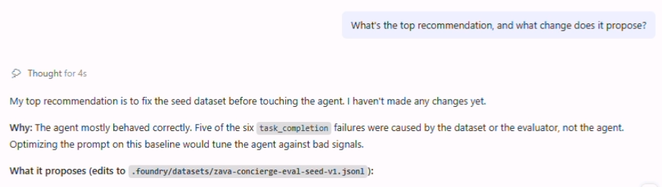
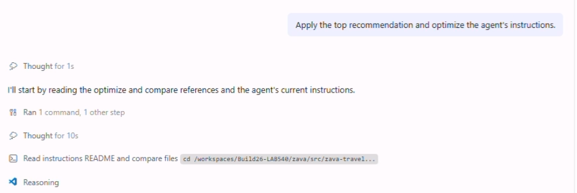

# Pick Top Fix

The skill has handed you a ranked list of recommendations. Now choose the one to
apply.

1. [] Review the recommendations Copilot produced.

1. [] Ask for the leading fix if you want it called out:

   +++What's the top recommendation, and what change does it propose?+++

   

1. [] Tell Copilot to apply that fix:

   +++Apply the top recommendation and optimize the agent's instructions.+++

   

>[!Knowledge] The recommendations are a **hypothesis generator**, not an oracle.
> Picking the top fix and measuring the result is exactly how the optimize loop
> is meant to work.

---

> ✅ **Success:** you've selected a recommendation and asked Copilot to apply it.
